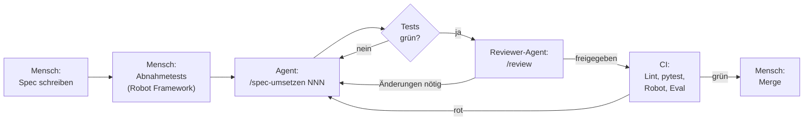

# Die Software-Fabrik hinter Praxis-Lotse

Praxis-Lotse wurde nicht von Hand programmiert. Ein Mensch hat festgelegt,
**was** gebaut wird und **woran man erkennt, dass es stimmt**. Coding-Agenten
(Claude Code) haben den Code geschrieben, ein zweiter Agent hat ihn geprüft,
und automatische Tests haben entschieden, ob er übernommen wird.

## Ablauf pro Feature

## Wer schreibt was?

| Artefakt | Autor | Geschützt? |
|---|---|---|
| `specs/*.md` (Anforderungen, API-Vertrag) | Mensch | Agent darf nur Status und Notizen ändern |
| `tests/acceptance/*.robot` (Definition von „fertig") | Mensch | ja, per `.claude/settings.json` und CI-Prüfung |
| `eval/fragen.yaml` (Qualitätsmaßstab für Antworten) | Mensch | ja |
| `data/` (fiktive Standorte, Patienteninformationen) | Mensch | – |
| `CLAUDE.md`, `.claude/` (Regeln, Befehle, Reviewer) | Mensch | ja |
| `backend/`, `frontend/`, `Makefile`, CI-Workflow, Unit-Tests | Agent | – |
| `docs/factory-log.md` (was beim Bauen passiert ist) | Agent, vom Menschen ergänzt | – |

## Warum so?

- **Der Engpass verschiebt sich vom Tippen zum Spezifizieren und Prüfen.**
  Ein Agent schreibt Code schneller als jeder Mensch. Ob der Code das Richtige
  tut, entscheiden Spec und Tests. Deshalb gehören sie dem Menschen.
- **Agenten dürfen ihre eigene Messlatte nicht verschieben.** Abnahmetests und
  Eval-Fragen sind für den Agenten schreibgeschützt. Die CI prüft zusätzlich,
  dass ein Pull Request diese Dateien nicht verändert.
  Die Sperre in `.claude/settings.json` ist die erste Hürde; das eigentliche
  Tor ist die CI-Prüfung, denn über die Shell ließe sich die Sperre umgehen.
- **Ein Agent bewertet nicht seine eigene Arbeit.** Der Reviewer läuft in einem
  frischen Kontext, kennt nur Diff, Spec und Regeln und darf nichts ändern.
- **Alles ist nachvollziehbar.** Jede Spec ist ein Branch, ein Pull Request,
  ein Eintrag im Factory-Log. Die Git-Historie zeigt, was der Agent wann warum
  gemacht hat.

## Was ein Mensch weiterhin entscheidet

- welche Probleme es wert sind, gelöst zu werden (mit den Fachbereichen)
- was „richtig" bedeutet, besonders bei medizinischen und rechtlichen Fragen
- ob ein Pull Request gemergt wird
- wann ein Agent auf dem Holzweg ist und neu angesetzt werden muss

## Nächste Ausbaustufe Richtung „Dark Factory"

1. Specs als GitHub Issues; ein Agent startet automatisch per GitHub Action,
   sobald ein Issue das Label `bereit` bekommt.
2. Automatischer Merge, wenn CI und Reviewer-Agent grün sind und keine
   geschützte Datei betroffen ist; der Mensch prüft stichprobenartig.
3. Eval-Ergebnisse als Trend über alle Merges, damit Qualitätsverluste sofort
   sichtbar werden.
